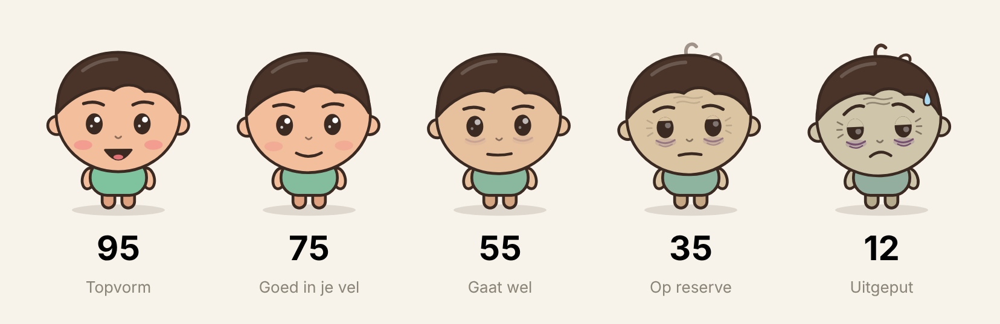

# FitBuddy

Een app voor iPhone en Android die laat zien hoe je erbij staat. Slaap, beweging en herstel worden één vitaliteitsscore van 0 tot 100, en een getekend poppetje laat die score zien met zijn gezicht en houding. Het poppetje zegt er ook iets van, kort en een beetje brutaal.



## Snel starten

Je hebt [Node.js 22](https://nodejs.org) nodig. Daarna:

```sh
npm install
npm run web
```

De app opent in je browser met demodata. Zo kun je alles bekijken zonder telefoon.

Een testversie als één los HTML-bestand, om te delen of in Chrome te openen:

```sh
npm run preview
```

Het bestand komt in `preview/fitbuddy-preview.html`. Open het via een webserver (bijvoorbeeld `npx serve preview`), niet door erop te dubbelklikken.

Op je telefoon kan het ook, met de app Expo Go (gratis in beide stores):

```sh
npm start
```

Scan de QR-code met je camera. In Expo Go draait de app met demodata, omdat Expo Go geen toegang heeft tot Apple Gezondheid of Health Connect. Voor echte data heb je een eigen build nodig, zie [docs/RELEASE.md](docs/RELEASE.md).

## Controleren of alles werkt

```sh
npm run check
```

Dit draait de typecheck, de linter en alle tests. GitHub doet hetzelfde bij elke push (zie `.github/workflows/ci.yml`).

## Waar staat wat

| Map | Inhoud |
|---|---|
| `src/core/` | Scoreberekening, labels, spraakwolkjes, opmaak. Pure logica, volledig getest. |
| `src/avatar/` | Het poppetje: parameters (`params.ts`) en tekening (`Pip.tsx`). |
| `src/health/` | Databronnen: Apple Gezondheid, Health Connect en demodata. |
| `src/store/` | Wat de app onthoudt, lokaal op het toestel. |
| `src/data/` | Hooks die bron, opslag en score aan elkaar knopen. |
| `src/ui/` | Kleuren, lettertype en kleine bouwstenen. |
| `src/app/` | De schermen. Elk bestand is een scherm (Expo Router). |
| `docs/` | Plan, architectuur, releasegids, storeteksten, privacybeleid en het originele design. |

## Documentatie

- [docs/PLAN.md](docs/PLAN.md) is het bouwplan en de gemaakte keuzes.
- [docs/ARCHITECTUUR.md](docs/ARCHITECTUUR.md) legt uit hoe de onderdelen samenwerken, en hoe je een signaal, scherm of poppetje toevoegt.
- [docs/RELEASE.md](docs/RELEASE.md) beschrijft stap voor stap hoe je de app op je telefoon zet en in de App Store en Google Play publiceert.
- [docs/STORE.md](docs/STORE.md) bevat alle teksten voor de store-vermeldingen en de review.
- [docs/privacy.html](docs/privacy.html) is het privacybeleid.

## Techniek

Expo (React Native) met TypeScript, Expo Router, react-native-svg en Reanimated. Gezondheidsdata via `@kingstinct/react-native-healthkit` (iOS) en `react-native-health-connect` (Android). Bouwen en publiceren via EAS.
